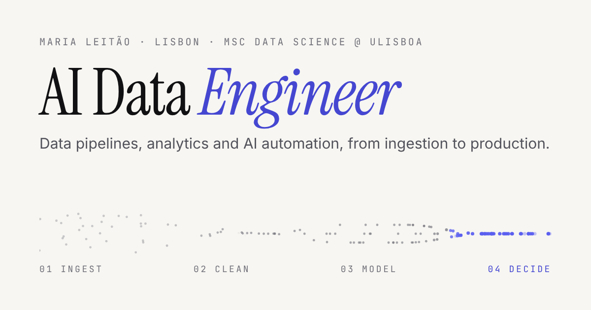

# Maria Leitão · Portfolio

Personal portfolio of Maria Leitão, AI Data Engineer based in Lisbon and MSc in Data Science student at the University of Lisbon.

**Live site:** [amarialeitao.github.io/me](https://amarialeitao.github.io/me/)



## What's inside

- **Hero with a pipeline animation:** a canvas animation of data moving through four stages (ingest, clean, model, decide). It pauses off screen and stays still when the visitor prefers reduced motion.
- **Case studies:** each project shows the problem, the result, the stack, a framed screenshot and a short pipeline diagram.
- **Three languages:** Portuguese, English and Spanish, each with its own URL (`/`, `/en/`, `/es/`), hreflang links and structured data for search engines.
- **Light and dark themes**, a responsive layout from mobile to wide screens, and privacy-friendly visit counting with GoatCounter (no cookies).

## Stack

- [Next.js 16](https://nextjs.org/) (App Router, static export) and React 19
- TypeScript
- Tailwind CSS
- Deployed to GitHub Pages with GitHub Actions

## Running locally

Requires Node.js 20.9 or later.

```bash
npm install
npm run dev
```

Then open [http://localhost:3000/me](http://localhost:3000/me). The site is served under `/me` because of the GitHub Pages base path.

To build the static site into `out/`:

```bash
npm run build
```

## Project structure

```
src/
├── app/          # One route per language, shared HTML shell and metadata (site.tsx)
├── components/   # Page sections (Hero, CaseStudies, Experience, Now, ...)
├── contexts/     # Language and theme providers
├── i18n/         # Content in pt, en and es
└── lib/          # Shared constants (base path)
public/           # Images, certificates and the link preview image
```

All text lives in `src/i18n/*.json`, so content updates don't require touching the components.

## Deployment

Every push to `main` runs `.github/workflows/deploy.yml`, which builds the site and publishes `out/` to the `gh-pages` branch.

## Contact

[LinkedIn](https://www.linkedin.com/in/amarialeitao/) · [GitHub](https://github.com/amarialeitao)
